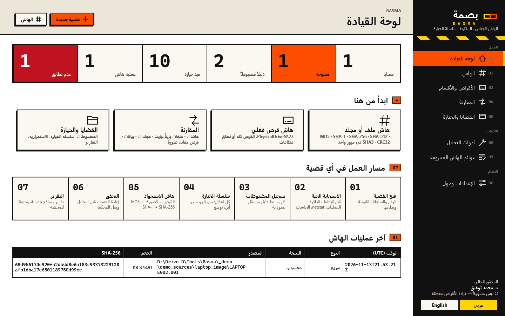
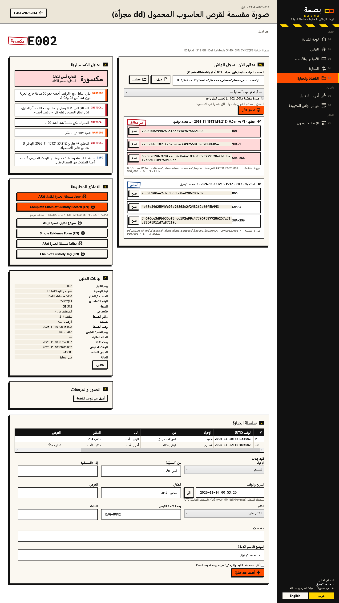
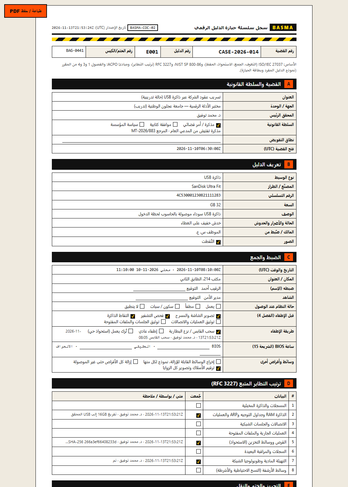

# بصمة · BASMA

**الهاش الجنائي، والأقراص، والمقارنات، وأدوات التحليل، وسلسلة الحيازة — في ملف تنفيذي واحد، دون خادم ودون تثبيت.**

*Forensic hashing (files, folders, drives, split images, physical disks), comparison, analysis tools and a hash-chained chain of custody — one Windows executable, Arabic / English.*



---

## التحميل والتشغيل

من صفحة **Releases**:

| الملف | الحجم | متى تستخدمه |
|---|---|---|
| **`Basma.exe`** | ~57 MB | **نسخة محمولة**: انسخها إلى فلاش وشغّلها مباشرة على أي ويندوز 10/11 64-bit، دون تثبيت أي شيء (.NET بداخلها) |
| `Basma-small.exe` | ~0.6 MB | للأجهزة التي فيها **.NET 9 Desktop Runtime** |

- البيانات تُحفظ في مجلد `BasmaData` **بجانب الملف** (على الفلاش نفسه)، فتنتقل قضاياك معك.
- اكتب اسمك كمحقق في **الإعدادات** أولاً.
- **قراءة الأقراص الفعلية تحتاج صلاحيات المسؤول**. زر «أعد التشغيل كمسؤول» يظهر عند الحاجة.
- النسخة المحمولة تفك مكتبات WPF الأصلية في مجلد `%TEMP%` على الجهاز عند أول تشغيل. على جهاز مشتبه به، **وثّق ذلك** كأثر للفحص الحي، أو حلّل نسخته على جهاز المختبر.

> الأداة تفتح الأقراص **للقراءة فقط**، لكن ويندوز نفسه قد يكتب على أي قرص موصول. للأدلة الحقيقية استخدم **حاجب كتابة عتادياً**.

---

## ماذا تفعل؟

### 1. الهاش — أي مصدر، بسبع خوارزميات في مرور واحد
MD5 · SHA-1 · SHA-256 · SHA-384 · SHA-512 · SHA3-256 · CRC32

| المصدر | ما يحدث |
|---|---|
| **ملف** | هاش، وتوقيع الملف، والإنتروبيا، وتنبيه خاص بملفات E01 |
| **مجلد (كل الملفات)** | بيان لكل ملف (المسار، والحجم، والهاش، وأزمنة MAC، والتوقيع، والإنتروبيا، والمكررات، وقوائم الهاش المعروفة) مع **هاش للمجلد كله** |
| **قرص / USB (كل الملفات)** | الشيء نفسه لقرص كامل بحرفه (`D:\`)، أي العرض **المنطقي** |
| **صورة مقسّمة** `.001 .002 …` | تُحسب كتيار واحد متصل |
| **قرص فعلي (خام)** `\\.\PhysicalDriveN` | بت ببت للجهاز كله، أو **لنطاق قطاعات**، أو **لقسم واحد** بالنقر على جدول الأقسام؛ والقطاعات غير المقروءة تُستبدل بأصفار وتُسجَّل |
| **قسم (خام)** `\\.\C:` | قطاعاً بقطاع |

**مرشحات للمجلد والقرص:** أنواع محددة (`*.docx;*.pdf`)، وتجاوز المخفي، وتجاوز ملفات النظام، وحد أقصى للحجم.
**تحقق إضافي:** قراءة ثانية للتأكد من ثبات الهاش، ومقارنة بهاش متوقع تُعرف خوارزميته من طوله.
**تصدير:** تقرير HTML ببصمة، وبيان CSV، وملفات `.md5` و`.sha1` و`.sha256` بصيغة `sha256sum`.

### 2. الأقراص والأقسام
الطراز، والرقم التسلسلي، ونوع الناقل، والحجم، وحجم القطاع، والأقسام. ثم **جدول الأقسام MBR/GPT** من القرص نفسه، و**المساحات غير المقسّمة**، والقطاع 0 بالست عشري، وأزرار لكل قسم: «هاش كل الملفات» و«هاش القسم الخام».

### 3. المقارنات
هاشان (مع تلوين الاختلاف) · ملفان **بايتاً ببايت** مع الإزاحة الدقيقة · مجلدان (معدّل / محذوف / مضاف / **منقول أو أعيدت تسميته**) · مجلد مقابل **بيان محفوظ** · مصدران بالهاش (**القرص مقابل صورته dd**).

### 4. أدوات التحليل

| الأداة | الوظيفة |
|---|---|
| **التصوير الجنائي (dd)** | صورة خام بت ببت لقرص أو قسم أو ملف، مع الهاش أثناء القراءة، وتقسيم اختياري (650MB / 2GB / 4GB)، و**تحقق** بإعادة قراءة الصورة، وسجل نصي كما في FTK. وترفض الكتابة على القرص نفسه الذي يُصوَّر |
| **البحث بالكلمات والأنماط** | بحث **مادي** في البايتات الخام: ASCII وUTF-16، وأنماط ست عشرية، وأنماط جاهزة (بريد، وروابط، وIP، ومحافظ بيتكوين، وبطاقات، وهواتف). يجد النص حتى في المحذوف ومساحة الفراغ |
| **فحص التوقيعات والنحت** | يجد الملفات من توقيع رأسها، و**يستخرج** JPEG وPNG وGIF وPDF وZIP/Office من الرأس إلى الذيل، مع هاش كل ملف مستخرج |
| **النصوص (Strings)** | سلاسل ASCII وUTF-16 داخل أي ملف أو صورة أو قرص، مع تصفية |
| **خريطة الإنتروبيا** | أين البيانات مشفرة أو مضغوطة وأين هي فارغة (لكشف الحاويات المخفية والمناطق الممسوحة) |
| **التحقق من المسح** | يثبت أن القرص الهدف نظيف جنائياً (كل القطاعات أصفار) قبل نسخ الأدلة إليه |
| **ملف قيم الهاش** | يتحقق من ملفات `md5sum`/`sha256sum` (مثل `sha256sum -c`) |
| **سجل أجهزة USB** | الأجهزة التي وُصلت بهذا الحاسوب يوماً، من السجل (USBSTOR)، للقراءة فقط |
| **عارض البايتات والمفسّرات** | ملف أو قرص بالإزاحة أو بالقطاع، ومفسّر القيم (LE/BE، وFILETIME، وUnix، وDOS، وGUID)، ومفسّر الأزمنة، وفحص التوقيع والإنتروبيا، والتحقق من بصمة المستندات |
| **قوائم الهاش المعروفة** | استيراد KFF/NSRL أو قوائمك (خبيث / سليم / لافت)، تُطابَق آلياً في كل هاش مجلد |

### 5. القضايا وسلسلة الحيازة
- القضية والسلطة القانونية، والمضبوطات مع **انحراف ساعة BIOS**، و17 نوع قيد حيازة.
- **تحليل استمرارية آلي** يعطي «سليمة» أو «تحذيرات» أو «مكسورة»، ويكشف: انقطاع التسليم، والختم المكسور، والقيد غير الموقّع، والفجوة الزمنية، وعدم تطابق الهاش، والقطاعات غير المقروءة.
- **هاش الاستحواذ والتحقق** من القرص مباشرة، مع فروق الملفات.
- **قائمة إجراءات المسرح** (18 خطوة)، و**التقاط الحالة الحية** (13 أمراً، كل مخرج يُحفظ بهاشه)، والخط الزمني مع تصحيح الانحراف، والملاحظات والمرفقات، و**حزمة للمحكمة**.



### 6. سجل سلسلة الحيازة الكامل للطباعة
لكل دليل، أو لكل المضبوطات، أو **نسخة فارغة للميدان**. بالعربية والإنجليزية، وبحجم A4، وفيه خانات للتوقيع اليدوي. وفق ISO/IEC 27037 وNIST SP 800-86 وRFC 3227 ومبادئ ACPO:

**A** القضية والسلطة القانونية · **B** تعريف الدليل · **C** الضبط (حالة النظام، وإجراءات ما قبل الإطفاء، وطريقة الإطفاء، وساعة BIOS) · **D** ترتيب التطاير · **E** التحريز والأختام والنقل · **F** الاستحواذ والتحقق (حاجب الكتابة، والأداة، والطريقة، والهاش) · **G** سجل الانتقال (المسلِّم والمستلم بالاسم والتوقيع، والغرض، والمكان، والختم) · **H** التحقق من الاستمرارية · **I** التصرف النهائي · **J** المبادئ المتبعة · **K** الإقرارات والتوقيعات

إضافة إلى **نموذج الدليل المفرد** و**بطاقة الحيازة**. كل مستند يحمل بصمة SHA-256 تكشف أي تعديل بعد إصداره.



---

## كيف تثبت «بصمة» نزاهتها؟
- كل قضية مجلد فيه `ledger.jsonl`: سجل لا يُحذف منه شيء، وهاش كل سطر = `SHA-256(هاش السابق ∥ السطر)`. **حالة القضية تُبنى من السجل نفسه**، وتعديل حرف واحد يُظهر «السجل مكسور» عند ذلك القيد.
- قيود الحيازة والهاش لا تُعدّل؛ التصحيح قيد جديد يشير إلى القيد الخاطئ.
- كل بيان ومرفق وتقرير مسجل بهاشه، ويُفحص عند كل تقرير.
- بصمة المستندات = SHA-256 لملف HTML بعد استبدال قيمة البصمة بـ 64 صفراً.

## الاختبار
**الإعدادات ← شغّل الاختبار الذاتي** أو `Basma.exe --selftest log.txt --data <مجلد مؤقت>`: **50 فحصاً** على بيانات مولّدة بنتائج معروفة. تشمل:
- قيم مرجعية لكل الخوارزميات، وصورة مقسّمة، وهاش مجلد، وتوقيعات، وإنتروبيا، وقوائم هاش، ومرشحات.
- مقارنة بايتات، وفروق مجلدات، والسجل وكشف العبث به، والتقارير والنماذج وكشف تعديلها، وتحليل GPT، ومفسّر الأزمنة.
- التصوير المقسّم مع التحقق، والبحث (بريد، وروابط، وUTF-16، وأنماط ست عشرية)، والنحت (JPEG مطابق بالبايت)، والنصوص، والتحقق من المسح، وملفات قيم الهاش، وسجل الحيازة الكامل.

**قضية تدريبية خيالية:** `Basma.exe --demo --data D:\BASMA_demo` تنشئ القضية `CASE-2026-014`: دليل بسلسلة سليمة، وآخر بسلسلة **مكسورة عمداً** لتدريب الطلاب.

## البناء من المصدر
```
# portable (no .NET needed)
dotnet publish -c Release -r win-x64 --self-contained true -p:PublishSingleFile=true -p:IncludeNativeLibrariesForSelfExtract=true -p:EnableCompressionInSingleFile=true -p:DebugType=none -o dist_portable
# small (needs .NET 9 Desktop Runtime)
dotnet publish -c Release -r win-x64 --self-contained false -p:PublishSingleFile=true -p:DebugType=none -o dist
```
WPF / .NET 9، دون أي حزمة خارجية.

## المطوّر
**د. محمد توفيق**، قسم الأمن السيبراني، جامعة عجلون الوطنية، الأردن · ORCID [0000-0002-1227-387X](https://orcid.org/0000-0002-1227-387X)
الرخصة: MIT
